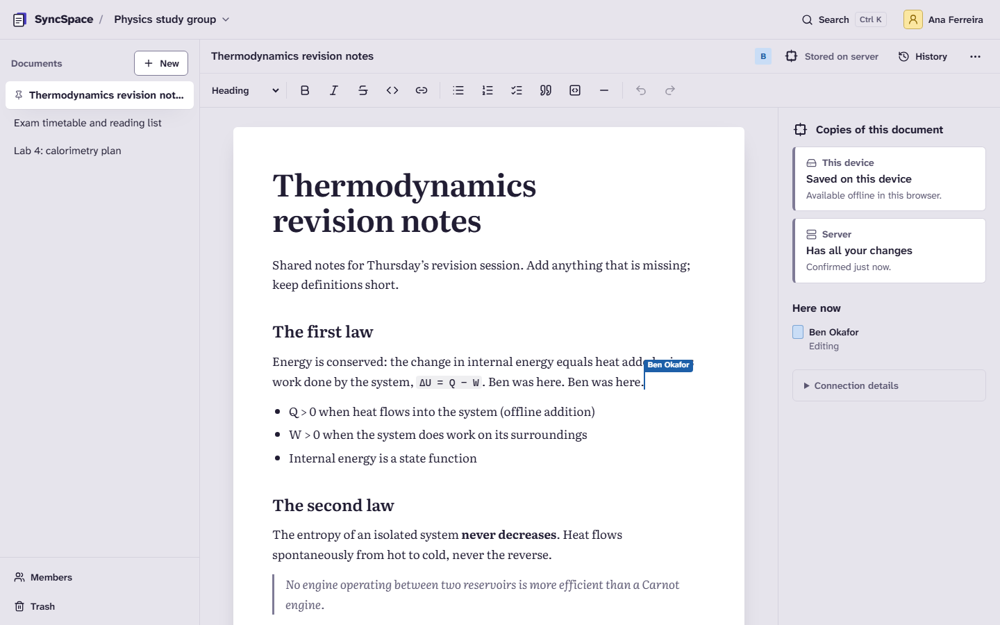
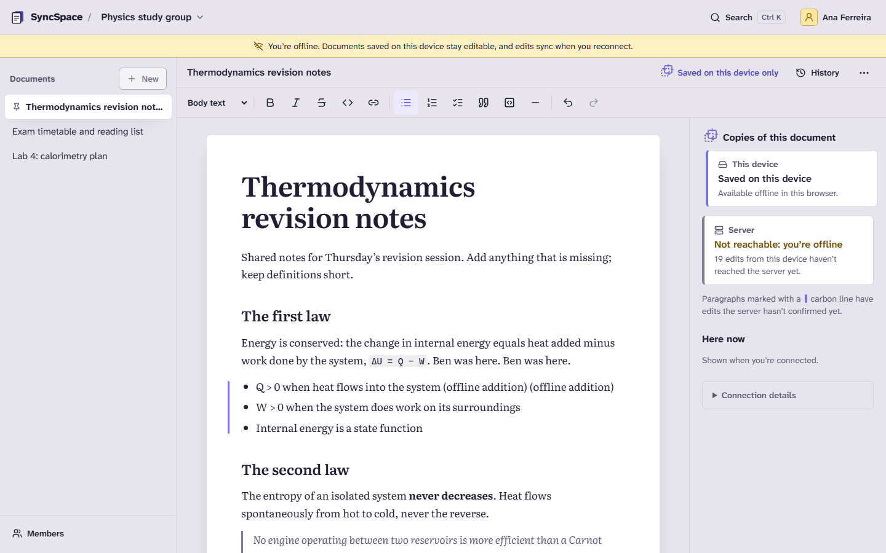
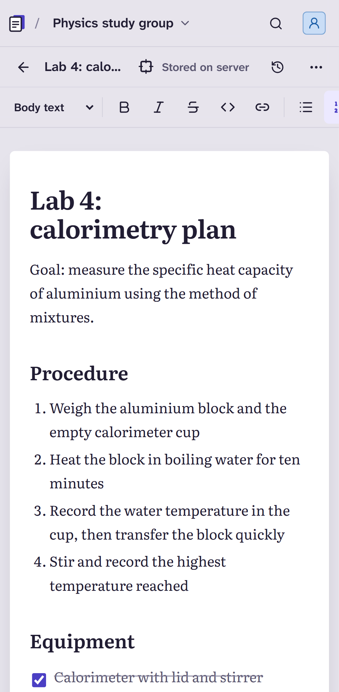
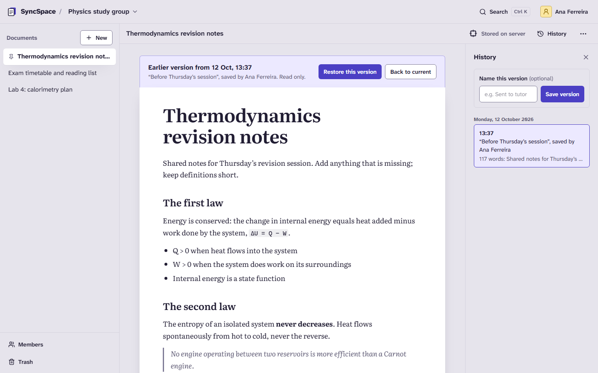
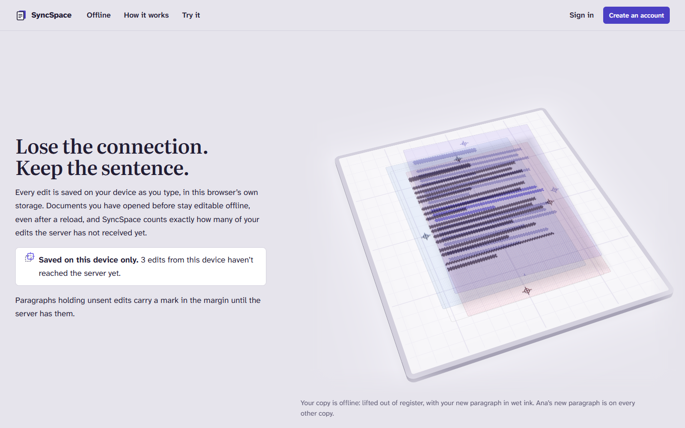
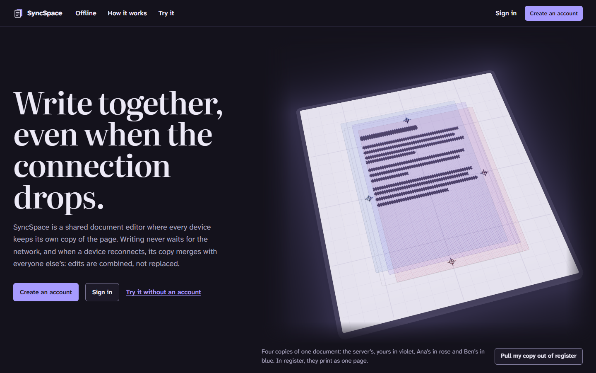
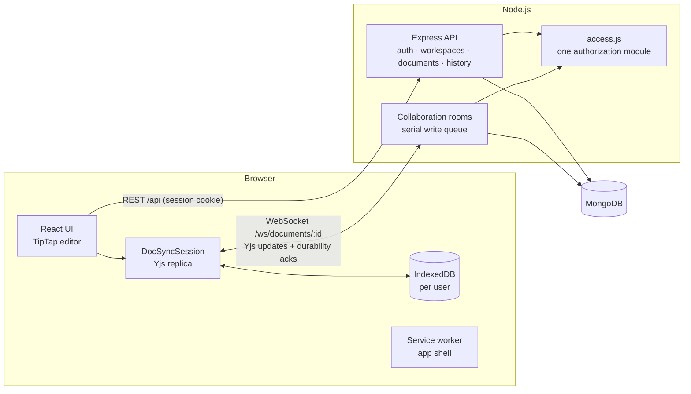
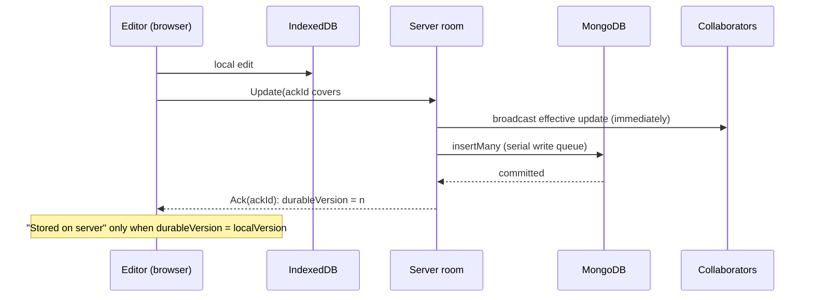

# SyncSpace

SyncSpace is an offline-first collaborative workspace for creating and editing documents together in real time. Built with React, Node.js, Express, MongoDB, Yjs, and WebSockets, it focuses on conflict-free collaboration, reliable synchronization, and an original, interactive user experience, all powered by JavaScript.

**The promise:** people can work on the same document at the same time, keep working when connectivity disappears, and trust that their changes converge and persist when it returns. The interface only says a change is stored on the server after the server has written it to MongoDB.



| Offline: edits only on this device, marked in the margin | Phone layout | History preview with safe restore |
|---|---|---|
|  |  |  |

The landing page at `/` explains the idea on a **light table**: each copy of a document is a translucent sheet printed with a halftone screen. A copy that goes offline lifts out of register, and its screen beats against the others as moiré; on reconnect its ink travels to the server and back into the other copies. It is drawn with Three.js and React Three Fiber on WebGPU, falling back to WebGL 2 and then to an SVG drawing ([design and technology](docs/landing-page-design.md)).

| The offline chapter (WebGPU) | Dark mode |
|---|---|
|  |  |

## Contents

- [What it does](#what-it-does)
- [Quick start](#quick-start)
- [Environment variables](#environment-variables)
- [Architecture](#architecture)
- [How synchronisation works](#how-synchronisation-works)
- [Design](#design)
- [Testing](#testing)
- [Measured results](#measured-results)
- [Deployment](#deployment)
- [Known limitations](#known-limitations)
- [Project structure](#project-structure)

## What it does

- **Accounts and sessions:** registration, sign-in and sign-out. Passwords are hashed with Argon2id. Server-side sessions use HttpOnly cookies with an absolute lifetime and an idle timeout. A session ending mid-edit asks you to sign in again without leaving the page.
- **Workspaces and roles:** owner, editor and viewer roles, enforced on every HTTP route and WebSocket connection. Invitation links are single-use, expire, and work only for the invited email address. Membership changes take effect on open connections immediately.
- **Documents:** a focused rich-text editor (TipTap/ProseMirror) with headings, emphasis, links (http, https and mailto only), lists, checklists, quotes, code and dividers. Documents can be pinned, renamed, moved to the trash and restored; only owners can delete them permanently.
- **Real-time collaboration:** Yjs CRDT merging, ply-coloured collaborator carets and names, and a live list of who is in the document and whether they have edits still on the way.
- **Offline-first:**
  - Every document you open is kept in this browser's IndexedDB, and the app shell is precached by a service worker.
  - Documents on the device open and stay editable with no connection, even after a full page reload.
  - Unsent edits are counted exactly; that count persists across reloads; they merge on reconnect.
  - Unsent edits are also sent in the background after you sign back in.
- **Honest status:** the header, registration mark and copies panel distinguish:
  - *saved on this device* (an IndexedDB commit);
  - *stored on the server* (an acknowledgement sent only after MongoDB has the change);
  - who else is present.
- **History:** automatic and named versions, read-only previews, and restore as an ordinary forward change that collaborators receive live. Every restore first saves a "Before restoring…" copy.
- **Nothing silently lost:** if a collaborator deleted a paragraph you edited offline, your pre-merge copy is saved to History and you are told.
- **Search** across your workspaces (titles and text, scoped to your memberships). Offline, it searches the titles of documents on the device.
- **Activity:** a short feed of meaningful events (joins, new documents, edit sessions, restores).
- **Landing page:** at `/` for visitors without a session (signed-in people go straight to their workspace). A story told beside a 3D light table, a live Yjs demo that drives it, the app's features, how storage works, and calls to action. See [docs/landing-page-design.md](docs/landing-page-design.md).

## Quick start

### Prerequisites

- Node.js 22.12 or newer, and npm 10 or newer
- Docker Desktop (for the local MongoDB). Any MongoDB 7 or 8 works, including Atlas, via `MONGODB_URI`.

### Run it locally (development)

```bash
cp .env.example .env               # then replace every change-me value (see below)
docker compose up -d --wait mongo  # MongoDB 8.0 on 127.0.0.1:27019, data in a named volume
npm ci
npm run db:check                   # verifies a write/read/delete round trip through Mongoose
npm run seed                       # optional: demo accounts, workspaces and documents
npm run dev                        # API on :4000, web app on http://localhost:5173
```

The seed prints three demo accounts (owner, editor, viewer) that share one password. [docs/demo.md](docs/demo.md) is a five-minute walkthrough of collaboration, going offline, history and roles. Use `npm run seed:reset` to recreate the demo data.

To generate the secrets for `.env`:

```bash
node -e "console.log(require('crypto').randomBytes(24).toString('hex'))"
```

`MONGO_APP_PASSWORD` and the password inside `MONGODB_URI` must match. The container's init script creates that least-privilege account (readWrite on the `syncspace` database only) the first time the volume is created. If you change it later, run `docker compose down -v`, which deletes local data.

### Run the production build with Docker

```bash
docker compose --profile app up -d --build   # MongoDB + the production image on http://localhost:8088
```

The image serves the API, the WebSocket endpoint and the built web app on one port. Health check: `GET /api/health`.

### Useful commands

| Command | What it does |
|---|---|
| `npm run dev` | API (auto-restart) and Vite dev server |
| `npm test` | Unit and integration tests in every workspace |
| `npm run test:e2e` | Builds the app and runs the Playwright suite against it |
| `npm run lint` | ESLint (JavaScript and JSX) |
| `npm run check:js-only` | Fails on TypeScript files, configs or dependencies |
| `npm run build` | Production build of the web app |
| `npm run verify` | JS-only check, lint, tests and build |
| `npm run db:up` / `npm run db:down` | Start or stop the MongoDB container |
| `node scripts/measure-sync.js` | Reproduces the sync measurements below |
| `node scripts/measure-landing.js` | Reproduces the landing-page load measurements (needs `npm run build` first) |

## Environment variables

All are read by the backend (`apps/server/src/config.js`, validated at startup). The `MONGO_*` values are read only by Docker Compose. Real environment variables override `.env`.

| Variable | Default | Purpose |
|---|---|---|
| `MONGODB_URI` | required | MongoDB connection string. `mongodb+srv://` works for Atlas. |
| `PORT` | `4000` | HTTP and WebSocket port |
| `NODE_ENV` | `development` | `production` enables Secure cookies, HSTS and serving the built web app |
| `APP_ORIGINS` | `http://localhost:5173` | Comma-separated browser origins allowed to call the API and open WebSockets |
| `SESSION_TTL_HOURS` | `168` | Absolute session lifetime |
| `SESSION_IDLE_HOURS` | `72` | Session ends after this long without use |
| `COOKIE_SECURE` | `true` in production | Set `false` only for plain-HTTP local runs. Also controls HSTS and `upgrade-insecure-requests`. |
| `TRUST_PROXY` | unset | Set (e.g. `1`) behind a reverse proxy or load balancer |
| `SERVE_WEB` | `true` in production | Serve `apps/web/dist` from the API |
| `RATE_LIMIT_LOGIN` | `10` | Sign-in attempts per 15 minutes per address and account |
| `RATE_LIMIT_REGISTER` | `20` | Registrations per hour per address |
| `LOG_LEVEL` | `info` | pino log level |
| `DB_CONNECT_MAX_ATTEMPTS` / `DB_CONNECT_RETRY_MS` | `10` / `500` | Startup connection retries (exponential backoff, capped at 10 s) |
| `MONGO_ROOT_USERNAME`, `MONGO_ROOT_PASSWORD` | change-me | Compose: MongoDB root account |
| `MONGO_APP_USERNAME`, `MONGO_APP_PASSWORD`, `MONGO_APP_DB` | change-me | Compose: the backend's least-privilege account |
| `MONGO_HOST_PORT`, `APP_HOST_PORT` | `27019`, `8088` | Compose: host ports (chosen to avoid a local mongod and common dev ports) |
| `SEED_PASSWORD` | `syncspace-demo-2026` | Password for the seeded demo accounts |
| `SPLINE_ORIGINS` | unset | Https origins a published Spline scene loads from (landing page). Unset: the CSP allows none. |
| `VITE_SPLINE_SCENE_URL` | unset | **Build time** (web app): the Spline scene's `.splinecode` URL. Unset: no Spline code is built. Docker: `--build-arg`. |

## Architecture

A modular monolith on one origin ([ADR 0001](docs/adr/0001-architecture.md)): one Node.js process serves the REST API, the WebSocket collaboration endpoint and, in production, the web app.



| Package | Responsibility |
|---|---|
| `packages/shared` | Role and permission matrix, wire protocol, limits. Used by server enforcement and client UI alike. |
| `packages/sync-client` | The offline-first sync engine and per-user IndexedDB store. Runs in browsers and in Node tests. |
| `apps/server` | Express API, sessions, authorization, WebSocket rooms, persistence, history, activity, diagnostics |
| `apps/web` | React 19 + Vite + Tailwind CSS 4 interface |

**Data in MongoDB:**

| Collection | Contents |
|---|---|
| users, sessions | Session tokens stored only as SHA-256 hashes; TTL-indexed |
| workspaces, memberships, invitations | Invitation tokens hashed |
| documents | Metadata only; title and search text are derived from the content |
| docupdates | Append-only log of effective Yjs updates, unique `(docId, seq)` |
| doccheckpoints | Compacted state, written before covered updates are deleted |
| docversions | Self-contained snapshots for history |
| activities | The activity feed |

Presence is never stored. Decision records:

- [0002 collaboration protocol](docs/adr/0002-collaboration-protocol.md)
- [0003 persistence and history](docs/adr/0003-persistence-and-history.md)
- [0004 offline storage](docs/adr/0004-offline-storage.md)
- [0005 advanced graphics](docs/adr/0005-advanced-graphics.md)
- [0006 authentication](docs/adr/0006-authentication.md)
- [0007 3D graphics on the landing page](docs/adr/0007-landing-page-graphics.md)

## How synchronisation works



- **Versions, not guesses.** Every local change increments `localVersion`, written in the same IndexedDB transaction as the change. Server acknowledgements advance `durableVersion`. Their difference is the exact number of edits that exist only on this device. It survives reloads and is capped so it can never under-report.
- **Reconnects resend nothing by hand.** On every connection the client answers the server's state vector with `SyncStep2`. That diff contains everything the server lacks, deletions included. Unacknowledged frames therefore never need individual tracking, and replays are harmless: duplicates produce no effective update and no stored record.
- **Write failures evict.** If MongoDB rejects a write, the room disconnects everyone and reloads from storage, and clients resend everything unacknowledged. The server never holds in memory a change the database lacks while claiming otherwise.
- **Authorization on the socket.** The handshake checks the Origin header, the session cookie and the membership. Viewers' changes are refused (and kept on their device, not dropped). Presence identity is overwritten with the authenticated user. Sessions and memberships are revalidated every minute and on every change.
- **One editing tab per document** per browser profile (Web Locks), with "Edit here instead" to move it.
- **Recovery.** CRDTs let deletions win. If a collaborator deleted a paragraph containing your unsent offline text, the client detects deleted items the server had never seen, saves its pre-merge state as a "recovered" version, and tells you.

## Design

The visual identity was derived from the product's core idea: every replica is a sheet in a carbon-copy set. Copies that agree are *in register*. A device holding unsent edits slips out of register, and its unsent paragraphs carry "wet ink" that dries when the server stores them. Collaborators are identified by the tinted *ply* colours of multi-part forms. Literata is used for what people write and Atkinson Hyperlegible Next for what the interface says.

- [docs/design.md](docs/design.md): concepts compared, tokens with measured contrast, layouts, and a review of the plan against generic defaults
- [docs/design-reviews.md](docs/design-reviews.md): screenshot reviews of the built app and what changed
- [docs/design-skills.md](docs/design-skills.md): how the design plugins and skills were installed and used
- [ADR 0005](docs/adr/0005-advanced-graphics.md): Three.js, React Three Fiber, WebGPU and Spline were evaluated with a measured prototype. R3F would add 233 KB gzip (WebGL) or 422 KB gzip (WebGPU) for no user-visible gain, so the app's spatial ideas are built with CSS 3D transforms and SVG over real, selectable text.
- [docs/landing-page-design.md](docs/landing-page-design.md) and [ADR 0007](docs/adr/0007-landing-page-graphics.md): the landing page is the exception. Its light table uses Three.js, React Three Fiber and WebGPU (TSL materials and a compute-shader droplet simulation), lazy-loaded and kept out of the app. The page includes a Spline integration that is ready but has no original scene yet: authoring needs a signed-in Spline account (the remaining step is described there).

## Testing

| Suite | Count | Runs against |
|---|---|---|
| Server: auth, rate limits, permissions, documents, collaboration, offline, history, convergence, CSP, precompressed static delivery | 84 tests in 10 files | Real HTTP + WebSocket server, real MongoDB (in-memory or `TEST_MONGODB_URI`), the real sync engine |
| Web: sync status wording, editor schema round-trips, link sanitising, landing-page choreography and animation | 42 | Node |
| Shared: protocol framing and roles | 7 | Node |
| End-to-end (Playwright, Chromium desktop and Pixel 7) | 15 | Production build served by the API, service worker active |

Highlights:

- **Convergence:**
  - 300 randomised runs at the CRDT level, with arbitrary delivery order and duplicates.
  - 15 randomised whole-system runs mixing random edits, network loss and simulated server crashes, each verified against a fresh load from storage.
  - The system test's failure mode was checked by injecting a bug that silently drops 10% of writes; the test caught it on its first run.
- **Durability:** acks only after MongoDB has the write, crash survival with no flush, compaction, write-failure eviction, and replay dedupe.
- **Offline:** reload while offline, interrupted acknowledgements, network flapping, a restart while offline, recovery of text removed by a merge, per-account storage, and a closed tab with lagging local writes.
- **Authorization:**
  - Every document route answers 404 to non-members.
  - Cross-workspace IDs are rejected, and search is scoped.
  - WebSocket joins are refused without a session, from foreign origins and for non-members.
  - Viewers' changes are refused, and presence spoofing is rejected.
- **End-to-end:**
  - Two accounts collaborate through a real invitation, one goes offline mid-edit, and they converge and persist.
  - The app reloads offline from the service worker.
  - Signing out offline keeps unsent work, which is sent in the background after the next sign-in.
  - Access control, an axe audit (no serious or critical WCAG 2.2 AA violations on six screens), and the phone layout.
  - The landing page:
    - calls to action, and the redirect for signed-in people;
    - the 3D stage renders (WebGPU, or WebGL 2 on the GPU-less CI runner);
    - it follows the story, and draws no frames when idle or off screen;
    - the live demo merges and drives the stage;
    - the SVG fallback when no 3D API exists;
    - reduced motion, axe, and no overflow at 320–412 px.

GitHub Actions ([ci.yml](.github/workflows/ci.yml)) runs the JS-only check, lint, all suites against a `mongo:8.0` service container, the production build, the Playwright suite and the Docker build on every push.

## Measured results

Measured with [`scripts/measure-sync.js`](scripts/measure-sync.js) on 2026-10-12. Each run used the real server and five Node clients running the same sync engine as the browser, against mongodb-memory-server (MongoDB 8.2.6), over **loopback on one machine**: Windows 11, Intel Core i7-13700HX, Node 22.13.1. These figures are server and database cost, not internet latency. Ranges cover three consecutive runs; the raw JSON is in [docs/measurements](docs/measurements).

| Measurement | p50 | p95 |
|---|---|---|
| One edit reaching all four other collaborators (200 edits) | 5.0–5.8 ms | 16.7–17.7 ms |
| One edit acknowledged as stored in MongoDB | 7.7–8.0 ms | 20.2–23.7 ms |
| Same, with all five people typing at once (500 edits) | 10.5–15.4 ms | 24.8–28.4 ms |
| Server write batch (`insertMany`, the database share of the above) | 2.4–3.1 ms | 6.0–7.0 ms |
| Opening the resulting document cold (922 paragraphs, 41.8 KB Yjs state) | 16–32 ms | 20–50 ms |

Reconnect catch-up after missing 200 remote edits while holding 20 offline edits took 18–52 ms until converged and stored.

**Web bundle** (production build):

- First load is about 160 KB of gzipped JavaScript, about 7 KB of it the landing page's HTML and choreography.
- The editor route lazy-loads a further 148 KB, and CSS is 11 KB.
- The landing page's 3D code is a separate lazy chunk: about 360 KB gzip, 281 KiB as Brotli on the wire. It is not part of the offline shell.
- The service worker precaches 1.4 MB (app shell and Latin fonts) for offline use.
- The server sends precompressed Brotli or gzip copies of the build.
- The production Docker image measured 301 MB before the landing page was added.

**Landing page** ([`scripts/measure-landing.js`](scripts/measure-landing.js), 2026-10-14). Cold loads of the production build through the real server over loopback, on Chromium 156 with WebGPU, three runs each (medians):

| | First contentful paint | First 3D frame | Transferred |
|---|---|---|---|
| Desktop, unthrottled | 180 ms | 938 ms | 587 KiB |
| Desktop, slow 4G + 4× CPU slowdown | 1.72 s | 4.79 s | 587 KiB |
| Pixel 7 emulation, slow 4G + 4× CPU slowdown | 1.81 s | 5.12 s | 587 KiB |

These are emulated network and CPU conditions on a fast machine; no physical phone was measured. Details are in [docs/landing-page-design.md](docs/landing-page-design.md#6-loading-fallbacks-and-performance).

No user counts or production traffic figures exist: SyncSpace has not been publicly deployed (see below).

## Deployment

The Docker image runs anywhere containers run, for example Render, Fly.io, Railway or a VPS, with MongoDB Atlas or any MongoDB 7 or 8:

1. Build and push the image (`docker build -t <registry>/syncspace .`), or let the host build from the repository's Dockerfile.
2. Set `MONGODB_URI`, `APP_ORIGINS=https://your.domain`, `NODE_ENV=production` and, behind a TLS-terminating proxy, `TRUST_PROXY=1`. Cookies are Secure and `__Host-` prefixed, HSTS is on, and the CSP allows WebSockets only to the configured origins.
3. Make sure the proxy forwards WebSocket upgrades on `/ws/` and allows long-lived connections.
4. Run **one instance**. Collaboration rooms, rate limits and metrics live in process memory (see limitations).
5. Optionally seed demo data once with `SEED_ALLOW_PRODUCTION=true SEED_PASSWORD=… node apps/server/scripts/seed.js`.

**Status:** not deployed. No hosting or Atlas credentials were available in this environment, so nothing is live and no deployed URL is claimed. The image was built, run with Compose and checked in a browser locally. CI builds it on every push.

## Known limitations

- **Single instance.** In-memory rooms, rate limits and metrics. Horizontal scaling would need sticky routing per document or a shared pub/sub layer.
- **One editing tab per document per browser profile.** A second tab offers "Edit here instead".
- **Some actions need the server:** creating workspaces and documents, invitations, history and full-text search. Offline search covers titles of documents on the device.
- **Offline availability is per device.** Only documents opened at least once in that browser are available offline. Others say so rather than showing an empty editor.
- **Delete wins in merges.** Offline text inside a paragraph someone else deleted disappears from the merged document. It is preserved as a "recovered" version, and you are told.
- **Tab-close window.** A page closed within milliseconds of a keystroke can lose that keystroke, because the browser had not delivered it to the editor yet. Everything the editor received is written to IndexedDB in the same tick.
- **Per-paragraph wet-ink marks are per session.** After a reload, the exact unsent count is still shown. Edits made by undo and redo are counted but not marked.
- **Trusted editors.** An editor could craft raw Yjs updates with forged client IDs. That is an integrity risk within a trusted role, not an authorization bypass.
- **Storage limits.** Versions are full snapshots, and a single checkpoint or version is limited to 16 MB (MongoDB document size). Automatic versions are capped at 50 per document; named ones are kept.
- **Search** scans derived text with a case-insensitive pattern. That's fine for small workspaces but not indexed for large ones.
- **No email.** Invitation links are copied and sent by hand. There is no password reset or email verification yet.
- **Local data is not encrypted at rest.** On shared computers, choose "Erase my offline copies" when signing out.
- **Dark mode follows the system setting.** There is no in-app toggle.
- **Intermittent test failure.** Before the shutdown and load hardening in commit `3ff3bb1`, the randomised whole-system convergence test failed 3 times in about 26 loaded suite runs. In each case every replica reported its edits stored, but one author's items were missing from the others. It has not reproduced in 55 full-suite runs since. The root cause was not confirmed; the test now prints room and replica diagnostics if it recurs.
- Measurements are loopback only; no WAN or mobile-network figures exist yet. The landing-page figures use emulated slow-4G throttling, not a real network.
- **Landing page:**
  - The Spline section has no original scene yet. It shows real screenshots until a scene URL is configured.
  - The page is client-rendered (no prerendering).
  - It was verified in Chromium only (WebGPU, WebGL 2 and the SVG fallback), not in Firefox, Safari or on physical phones.

## Project structure

```
apps/
  server/            Express API, sessions, WebSocket collaboration, persistence, tests
  web/               React app (features/, editor/, sync/, ui/, styles/)
packages/
  shared/            roles, protocol, limits
  sync-client/       offline-first sync engine + IndexedDB store
e2e/                 Playwright end-to-end tests
docs/                design, reviews, ADRs, demo walkthrough, measurements
docker/              MongoDB init script
scripts/             JS-only check, measurements, screenshots
```

JavaScript only: no TypeScript sources, configs, dependencies or build steps; `npm run check:js-only` enforces this in CI.
